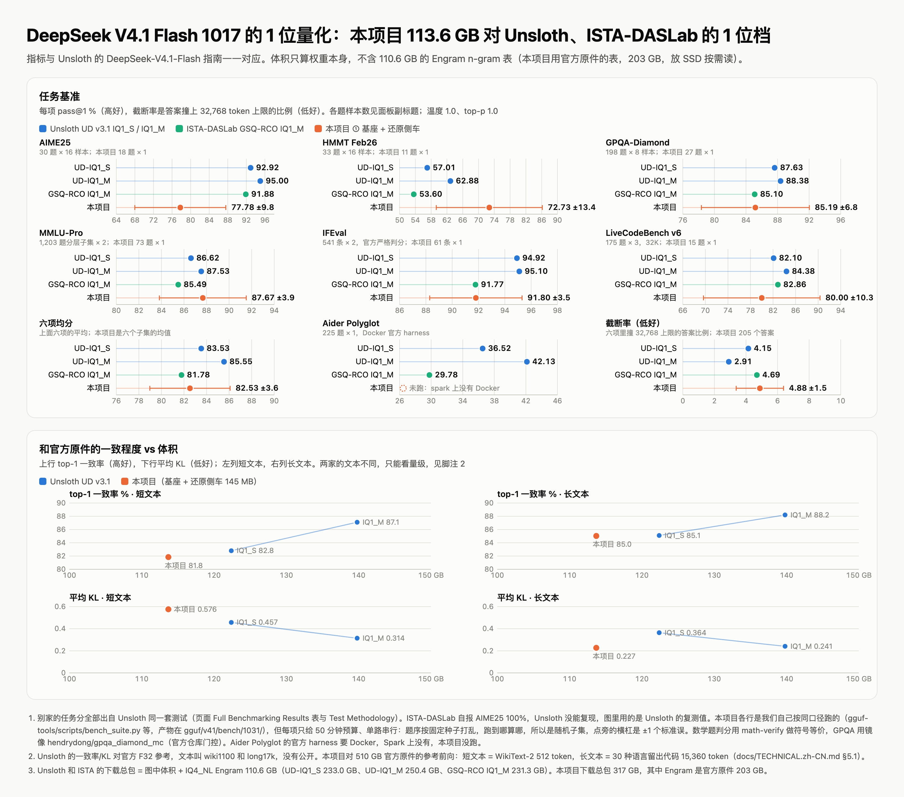
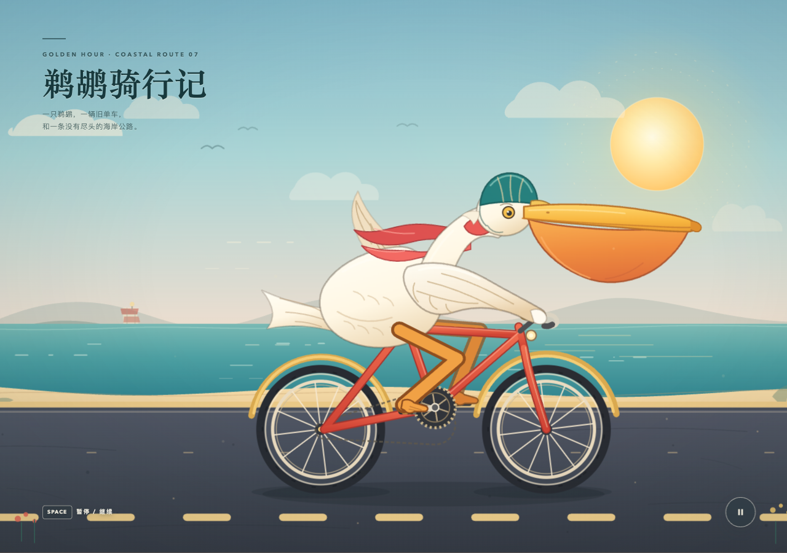

> **开发理念**
>
> 天下没有免费的午餐。量化省下的体积，一定会在别处付出代价。
>
> 我采用平权量化，目的是让每一个个人、每一个行业、每一个国家拿到的都是同一个一致的底座；
> 个性化的能力通过外挂实现（侧车、后训练文件），谁需要谁挂。
> 如果单纯为了指标好看而伤了边际能力，那不是我想要的。
>
> 下一步的目标：实现自进化还原。

<p align="center">
  
</p>

<h1 align="center">YoungAi</h1>

<p align="center">
  <b>住在你自己机器上的个人 AI 助理。</b><br>
  按住就能说话。记得你说过的事，会上网、会写 Word/PDF/PPT/Excel、会做视频、会盯着一件事持续跟进，<br>
  干完把结果交到手机上的下一个 app——模型、记忆、文件全在本机，数据不出门。
</p>

<p align="center">
  <a href="https://github.com/fodelf/YoungAi"><b>GitHub 仓库 · fodelf/YoungAi</b></a> ·
  <a href="https://fodelf.github.io/YoungAi/"><b>项目网站 · 使用指南</b></a> ·
  <a href="https://github.com/fodelf/YoungAi/blob/restructure/README.md">English</a> · <b>中文</b> ·
  <a href="https://huggingface.co/wenzhouwu/YoungAi-DeepSeek-V4.1-Flash-1017">Hugging Face</a> ·
  <a href="https://github.com/fodelf/YoungAi/blob/restructure/docs/TECHNICAL.zh-CN.md">技术细节</a>
</p>



**这张图里我们这边的数据集很小，只看量级，别当排名。** 每项基准只给了 50 分钟、单路串行，跑到的是随机子集，每题 1 个样本，
一共 205 个答案（AIME25 18、HMMT 11、GPQA 27、MMLU-Pro 73、IFEval 61、LiveCodeBench 15）。Unsloth 的数用的是全部题目，每题最多 16 个样本。
我们的误差棒从 ±3.5 到 ±13.4 个点。六项均分 82.5 ± 3.6，GSQ-RCO 81.8、UD-IQ1_S 83.5、UD-IQ1_M 85.6。
AIME25 偏低（77.8 ± 9.8，对方 92–95），HMMT 偏高（72.7 ± 13.4，对方 54–63），这个样本量下两边都不算定论。
Aider Polyglot 没跑：官方 harness 要 Docker，我们的 Spark 上没有。

同一句提示"创建一个HTML，内容是SVG绘制一个鹈鹕骑自行车的2D动画"，同一个 agent 流程（dsh）：

| 官方 DeepSeek V4.1 Flash（510 GB 原件，官方 API） | 本项目 10-27：还原侧车，自学习之前 | 本项目 10-30：自学习留下 8 轮之后 |
|:---:|:---:|:---:|
|  |  |  |

两趟本机都是 113.6 GB 平权量化底座 + 还原侧车、一台机器，中间只换了侧车里的修正部分；各跑一趟，不是挑出来的。

- **10-27**：第一稿渲染后、模型看图自查时的一帧，我们在这里停了这趟。喉囊画成圆球挂在短喙下，身子、翅膀、脖子糊成一团。
- **10-30**：终稿。模型自己写、自己看截图、看到问题自己改，72 次工具调用（38 分钟）后自己收手。长喙和沿着喙挂下来的喉囊有了；
  差距还在：脖子没有立起来，喉囊偏小，身子看着更像鸭子。

两趟之间，同一把尺：编程 Same top 84.3% → 85.0%（KL 0.252 → 0.230），通用英文 81.4% → 82.0%（KL 0.621 → 0.586）。
侧车怎么学的见下面的[模型](#模型)一节。


背后的模型是 DeepSeek V4.1 Flash 的 1017 版（官方权重 510 GB），压到 113.6 GB，一台 128 GB 的机器就能跑：
DGX Spark 或 Apple Silicon 的 Mac，1M 上下文。开源，MIT 协议；纯 C99，Spark 上用 CUDA，Mac 上用 Metal，
一个 Makefile，不链任何第三方库。

## 模型

113.6 GB 的基座，加一个 145 MB 的还原侧车，编程上下一个字和 510 GB 官方原件一致的比例（Same top）到了 **85.0%**：

| | 体积 | 编程 | 通用英文 |
|---|---:|---:|---:|
| ① 基座 | 113.6 GB | 78.4% | 76.8% |
| ① + ② 编程侧车 | + 41 MB | 82.0% | 79.7% |
| **① + 还原侧车（Spark 上默认）** | **+ 145 MB** | **85.0%** | **82.0%** |

"一致"指同一段文字上，我们的模型和原件挑出的最可能的下一个 token 相同。编程用的是 30 种语言、15,360 个 token 的
留出代码，通用英文是 WikiText-2。各行平均 KL：编程 0.446 → 0.318 → 0.230，通用英文 0.803 → 0.673 → 0.586。

**113.6 GB 能做到这个数，靠两件事：**

1. **多模态按需加载：用时装，用完卸。** 视觉塔 0.97 GB（原件 BF16）是单独一个文件，启动时只记下它在盘上的位置。
   来图时才读进显存，跑完就释放，文本请求一个字节不碰它。128 GB 内存因此几乎全给了文本主干：113.6 GB 的基座，
   每 8 个权重一起向量量化，约 1.6 bit/权重，不用训练数据。
2. **侧车 41 MB。** 给每个路由专家的每一行权重乘一个增益、给路由器加一点偏置，对着出厂原件解出来。
   金融 / 编程 / 法律 / 医疗 / 科研各一份，聊天框下拉切换，不到 1 秒。

**还原侧车**把两样东西放进一个目录：像 ② 那样的增益和路由偏置（40 MB），每层 MoE 输出上一个秩 64 的修正（105 MB）。
修正部分按轮向官方 API 学：每轮由 API 现写一批新的源文件，侧车在上面训一遍；编程尺的一半上 KL 降过 2 个标准误才留，
另一半只报数不参与去留。最后一轮训的是完整的思考过程，包括原件在哪里收住思考、在哪里结束回答，这一轮不设门直接留：
编程 KL 退了 1%，上面那趟鹈鹕自己收了手。到目前跑了 29 轮，留下 8 轮。训练料和两把尺没有任何 16 个 token 长的重合片段，
只有两行 Dockerfile 样板句例外。用法：把这个目录传给 `ds4-server --zchain`。

上下文 1M token，满载 KV 缓存 0.89 GB。测法和完整结果表见[技术细节第五章](docs/TECHNICAL.zh-CN.md#五实测结果)。

### 速度

| | DGX Spark（GB10，128 GB） | Mac Studio M5 Max（128 GB） |
|---|---:|---:|
| 读提示 | 1,040–1,070 token/s（9.2k token 提示） | 627 token/s（25.5k token 提示） |
| 写，投机解码（默认） | 48.2 token/s | 散文 35–36 token/s，代码 41–42 |
| 写，纯解码 | 29.9 token/s | 没测 |
| 谁测的 | 我们 | 一位贡献者（[#3](https://github.com/fodelf/YoungAi/pull/3)） |

两列用的是同一个 113.6 GB 基座，温度 0，各写 512 个 token。Spark 的数来自一条没拿来调过参的真实请求，挂编程侧车；
Mac 的数经 `ds4-server` 量，两趟取好的一趟。两边提示不同，只适合看量级，别逐位比。更多负载和上下文长度见
[技术细节 5.2](docs/TECHNICAL.zh-CN.md#52-速度)。

**Mac**：`make` 编出 Metal 版，133 项 GPU 核测试在真 Apple GPU 上全过。我们手上的 Mac 只有 16 GB，上表 Mac 整模型的数是贡献者量的。

## 它能干什么

**一句话进来，助理在沙盒里把活干完，再把成果交出去。** 上面那张图是实拍："帮我找全网最低价的 DGX Spark"，
16 分钟、12 轮、43 次工具调用，全在这台机器上跑完。

| 你说 | 它做 | 你拿到 |
|---|---|---|
| "附近有什么好吃的"（手机上） | 定位 → 搜周边 → 挑 3 家写理由 | 每家一个导航按钮、一个"打开美团 / 饿了么"按钮 |
| "把这份 Word 转成 PDF"（附件） | 在沙盒里转 | 文件卡：下载，或分享到微信 / 钉钉 |
| "查一下 X，整理成报告发给同事" | 搜网页、读原文、写 docx | 报告文件 + 系统分享面板 |
| "按月汇总这张表" | 读 csv，写带公式的 xlsx | 手机上直接能看数的 Excel |
| "做一个 30 秒的产品介绍视频，配旁白" | 写一页动画，逐帧渲染编码 | 带旁白的 mp4，手机系统播放器直接能播 |
| "盯着这个价格，降到 3 万以下告诉我" | 建任务，自己定多久再看一次 | 到了推送到你手机 |
| "记住我常住南京" | 写进记忆 | 以后推荐三日游自动从南京出发 |

助理手里的工具（模型看到的就是这张表，没有为哪个场景写死的提示词）：

| 类别 | 工具 | 说明 |
|---|---|---|
| 记忆 | `remember` `forget` | 只记你亲口说的；`~/.ds4/assistant/memory/` 下的纯文本，你能直接改 |
| 文件 | `read_file` `list_dir` `search_files` `write_file` `edit_file` | 默认只在工作区里；碰工作区外的路径先弹卡片问你 |
| 跑程序 | `run` | 在内核沙盒里执行命令：没网络、只能写工作区；本机装了 soffice / pandoc / python3 等就能用 |
| 上网 | `web_search` `visit_page` | 无头火狐，搜索 + 读正文 |
| 办公文档 | `write_document` `write_xlsx` | Markdown → docx / pdf / pptx；JSON → xlsx（公式现算）。全部自写，不装 Office |
| 视频 | `make_video` | 模型写 HTML 动画 → 自写 H.264/AAC 编码成 mp4，可配旁白 |
| 地点 | `locate` `nearby` | 手机定位 + 高德周边（填了高德 key 给真实 POI，没填退成按街道搜网页） |
| 交给手机 | `share` `copy_text` `navigate` `call` `open_url` `open_app` `read_clipboard` `pick_file` | 在你正在用的那台设备上执行；打开抖音 / 微信 / 钉钉 / 支付宝 / 美团 / 饿了么 |
| 持续跟进 | `task_check_in` `task_done` `notify` | 任务自己定下次几点再看；提醒和完成通知推到手机（Web Push） |
| 技能 | `use_skill` | `SKILL.md` 文件夹教它某类活怎么干（Agent Skills 格式，不许带脚本） |
| 云手机 | `phone_*` 六个 | 危险模式才有，见文末免责声明 |

### 语音输入：按住说话

和微信一样：输入框空着时最右边是麦克风，点一下切成"按住 说话"长条；按住说，松手**直接发出去**，往上滑松手就取消，
最长 30 秒。语音识别也在这台机器的 GPU 上跑，录音不出门。

- 识别模型是 [moonshine-tiny-zh](https://huggingface.co/moonshine-ai/moonshine-tiny-zh)（2700 万参数，108 MB），推理用本项目自己写的 C + GPU 核
  （CUDA / Metal），没有 Python 和 ONNX。在 Spark 上识别一段 3.4 秒的话要 51 毫秒。
- **只认中文。** 它是最小的那一档：论文在难测试集（众包录音、各种口音）上的错字率约 29%～36%，对着手机清楚地说会好得多，但比大模型差一个档次。
- **怎么开**：把模型的三个文件放进 `gguf/asr/moonshine-tiny-zh/`，再到"模型"页重新加载一次，输入框旁就会出现麦克风。没有这个目录时这个功能就不存在：不出麦克风，也不报错。

  ```sh
  mkdir -p gguf/asr/moonshine-tiny-zh && cd gguf/asr/moonshine-tiny-zh
  for f in config.json tokenizer.json model.safetensors LICENSE.txt; do
    curl -fLO https://huggingface.co/moonshine-ai/moonshine-tiny-zh/resolve/main/$f
  done
  ```

- 浏览器只在 https 或 localhost 下给麦克风。用 `http://局域网IP` 打开时没有麦克风，这时最右边只有发送键。
- 现状：Mac（Metal）和 Spark（CUDA）上的识别结果和官方参考实现逐字一致，Spark 的生产服务也冒烟通过了；真手机上试过几句（三句错两个字）；三台手机各念 10 句、统计错字率的正式验收还没跑。

## 安全：靠沙盒，不靠信任模型

- **每次工具调用都在一个新的子进程里，先上内核沙盒再干活**：Linux 是 Landlock + seccomp，macOS 是 Seatbelt。
  沙盒锁不上就拒绝执行。三十多项逃逸测试在 Mac 和 Spark 上都全过。
- **守门是一个确定性的 C 函数**，不是另一个模型当裁判：工作区外的写、删除要你点头（仅这次 / 本会话 / 总是）；
  参数里像密码、卡号、验证码的一律直接拒；助理自己的配置目录它碰不到，没法给自己开权限。
- **网页内容当不可信输入**：读过网页之后，外送类动作永久授权失效，只能"仅这次"。
- **每次动手记一行审计**（`audit.jsonl`），"活动"页能翻、能撤销授权。
- 诚实的边界：没有虚拟机隔离，助理以你的用户身份跑；机器被攻破，助理也就被攻破了。

## 上手

**DGX Spark**（Linux aarch64 + CUDA 13 运行库，SSD 空闲约 320 GB）。上网工具要火狐，Spark 上的 Ubuntu 自带。

```sh
# YoungAi —— GitHub 仓库 fodelf/YoungAi
git clone https://github.com/fodelf/YoungAi.git ~/ds4-main && cd ~/ds4-main
make cuda-spark
./ds4-train --host 0.0.0.0 --port 8000      # 浏览器打开 http://主机:8000/
```

1. **模型**页：点"下载"（约 317 GB，断点续传），再点"加载"（约 2 分钟）。
2. **助理**页：直接说话。对话、记忆、工作区都在 `~/.ds4/assistant/`。
3. **手机**：打开页面"添加到主屏幕"就是 App。定位、剪贴板、分享、推送这些要 https——在"设置"里填一台云服务器开穿透，
   或者用 Tailscale；步骤和排错见 [docs/pwa.md](docs/pwa.md)。
4. **任务**页：输入一句话交给助理持续跟。
5. **技能**页：新建或导入一个带 `SKILL.md` 的文件夹（仓库自带一份做 PPT 的 [`skills/pptx/`](https://github.com/fodelf/YoungAi/tree/restructure/skills/pptx)）。

工作台各页、每个工具怎么用、出错会怎样，见 **[使用指南](https://fodelf.github.io/YoungAi/guide.html)**。

**Mac**（Apple Silicon，128 GB 内存，SSD 空闲约 325 GB）：直接起模型服务。工作台的"下载""加载"按钮只在 Spark 上跑过。

```sh
# YoungAi —— GitHub 仓库 fodelf/YoungAi
git clone https://github.com/fodelf/YoungAi.git ~/ds4-main && cd ~/ds4-main
make                                                            # Metal 版
bash gguf-tools/scripts/hf_install.sh download --dir ~/youngai   # 约 317 GB，断点续传
M=~/youngai/model/DeepSeek-V4.1-Flash-1017-vq8sh14-q4k-mtpnative
./ds4-server --metal -m $M.gguf --zchain $M-grrb-code_fit_n15360-engine \
    --engram-dir ~/youngai/deepseek-engram --mem-budget-mb 110000 --port 8000   # :8000 上是 OpenAI / Anthropic 兼容 API
```

服务端报某段模型区间 *not covered by mapped model views*，说明代码是支持 Mac 之前的版本：拉最新代码重新 `make`。

## 还能干的两件事

**用你自己的数据训练。** 一行一个 JSON，格式和 Unsloth 一样；"语料"页拖进去，"训练"页点开始。
训完不会自动挂上，聊天框旁的"后训练"开关打开才用。完整走一遍见[技术细节 4.3](docs/TECHNICAL.zh-CN.md#43-后训练文件)。

```json
{"messages":[{"role":"user","content":"入场价是多少？"},{"role":"assistant","content":"30.39"}],"context":"……原文材料……"}
{"text":"一段原文，原样训（续训）。"}
```

**当 API 用。** `/v1/chat/completions`、`/v1/completions`、`/v1/responses`、`/v1/messages`（OpenAI / Anthropic 兼容）。
先在"API"页建一把密钥，请求带 `Authorization: Bearer <密钥>`（本机调也要，不带回 401）。`"temperature": 0` 每次输出逐字节相同。
装了识别模型时还多一个 `/v1/audio/transcriptions`：请求体直接放 16 kHz 单声道 WAV（不是 OpenAI 的 multipart 表单），返回 `{"text":"…"}`；
别的采样率或格式会回 400，并说明收到的是什么。
只要 API 不要工作台、不想编译：

```sh
curl -fsSLO https://huggingface.co/wenzhouwu/YoungAi-DeepSeek-V4.1-Flash-1017/resolve/main/install.sh
bash install.sh                      # 默认编程侧车，--domain law 换领域；--endpoint https://hf-mirror.com 走镜像
```

## 局限

- 我们在 DGX Spark 上做端到端验证。Mac 整模型的数来自贡献者的 M5 Max；我们手上的 Mac 只有 16 GB，只跑 GPU 核测试。
- 一台机器一份模型：后台任务和你聊天是排队跑，不是并行。
- 要登录或有验证码的网站，助理打不开；它会说哪些没打开，不会去猜。
- 各领域侧车只在留出文本上评过分。还原侧车另外跑过本页顶部的任务基准，用的是小子集。

## 危险模式（实验性）· 免责声明

设置里有一个**危险模式**开关，**默认关闭**。打开后主机上会起一部虚拟 Android 13 手机（只在 Linux 主机上有：内核要有
`binder`，macOS 跑不了），模型多六个 `phone_*` 工具：看屏、点、滑、按键、打字、开 app。工作台多一个**云手机**页签显示实况
（H.264 流，浏览器自己解），`/api/phone/*` 是一张普通的 REST 表，页面、模型和你的脚本走的是同一套
（[`docs/assistant_phone.md`](https://github.com/fodelf/YoungAi/blob/restructure/docs/assistant_phone.md)）。拨开关之前先读完这几条：

- **模型是自主操作的。** 危险模式打开后，普通点击没有人逐步确认。手机起来是空的（没有 SIM、没有账号、没有应用商店），
  但**你在里面登录的任何账号、装的任何 APK，模型都能用**——它可能发消息、下单、付款、删东西。后果由打开开关的人承担。
- **真正付钱的那一步，每次都先问你。** 填金额、点"转账 / 立即购买"这类去付款页的按钮都不问；在 app 自己标成安全窗口的页面
  （密码、支付、登录页）上、或点写着"确认支付 / 提交订单 / Pay"这类字的按钮之前，弹一张红卡：现场截图 + 要点的位置 + 屏幕上的金额；
  安全窗口截不了图，就放进它之前的最后一屏（看得到给谁、多少钱）。只能"仅这次"，不会记住；在安全窗口上批一次管这一页，离开就失效。
  安全窗口上模型不能打字，密码由你在"云手机"页签里自己输。认不出来的情况：最后那个付款按钮没有界面文字、页面又没标安全窗口，会不问直接过去。
- **屏幕上的内容对模型是不可信输入。** app 和网页里的文字可能诱导模型做事。手机跑在自己的命名空间里，有内存硬顶，碰不到你的
  内网和宿主，但这不是对一切滥用的保证。
- **不会替你过风控。** app 弹出滑块验证或风控页时，你自己在云手机页签上滑；没有任何提示词让模型去绕它。别用它绕过任何 app 的
  服务条款或他人的权利。
- 手机系统是第三方镜像（[redroid](https://github.com/remote-android/redroid-doc)，Apache-2.0），由本项目的运行时
  （`ds4-phone`，约 600 行 C，不用 Docker）直接拉起；一次性准备要 `sudo` 一次（`scripts/phone_prepare_linux.sh`）。
- 实况视频要安全上下文（https，或按 `localhost` 打开页面）；用 `http://局域网IP` 打开时浏览器不给 WebCodecs，页签退回每秒一张截图。

## 作者 · 致谢 · 许可证

吴文周 · 310066827@qq.com。欢迎来信交流、反馈复现结果或谈合作；Bug 和 PR 提到 [GitHub 仓库 · fodelf/YoungAi](https://github.com/fodelf/YoungAi)。

本项目起步于 [antirez/ds4](https://github.com/antirez/ds4)（DwarfStar，Salvatore Sanfilippo 为 DeepSeek V4 写的推理引擎）
的分叉；GGUF、q4_K 等布局和大量核经验来自 [llama.cpp 与 GGML](https://github.com/ggml-org/llama.cpp)，GGML 的版权声明
保留在 `LICENSE`。模型属于 DeepSeek，感谢公开权重和参考代码。

引擎 MIT（[`LICENSE`](LICENSE)）；量化权重派生自 DeepSeek V4.1 Flash（1017 版），同为 MIT（[`LICENSE-DeepSeek`](LICENSE-DeepSeek)）。

语音输入 Powered by Moonshine AI。识别模型 moonshine-tiny-zh **不是 MIT**，用的是 Moonshine AI Community License：研究和非商用免费；
商用要先到 moonshine.ai/community-license 登记，你和关联方年营收超过 100 万美元时许可自动终止，得另谈；不许拿它的输出去训练基础模型。
本仓库不带它的权重，用不用由你决定。
